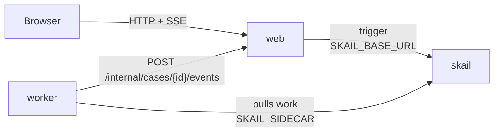

# skail agent with tools (Node / TypeScript + React)

[Português (Brasil)](README.pt-BR.md)

A customer support agent built on skail. A skail function runs the agent in a loop: at each step a model decides to use a tool (look up an order, track a delivery) or to answer the customer. Each decision and each tool call is a recorded step, so if the worker stops in the middle of a case, the case resumes after the last recorded step without asking the model again. With no answer in 6 steps, the case goes to a person with the whole conversation. With an OpenAI key the model is OpenAI; without one, an offline sample planner decides, so the demo runs with no other account. A React page sends the customer's message and shows each step of the agent live.

The demo covers three topics of the [skail docs](https://docs.skail.dev) (in Portuguese):

- [AI agent with tools](https://docs.skail.dev/construa/casos-de-uso/agente-de-ia-com-ferramentas): the model call and each tool call are commands, and the loop is ordinary code in the function;
- [replay and determinism](https://docs.skail.dev/construa/conceitos/replay-e-determinismo): the function only reads recorded results, so a resumed case rebuilds the conversation without calling the model again;
- [retries and idempotence](https://docs.skail.dev/construa/conceitos/retries-e-idempotencia): a failed model call is retried, and the tools only read data, so retrying them has no side effect.

## How it works



- **worker** (`apps/worker`): the function `AssistCustomer(caseId, question)` and its commands, in [`support-agent.ts`](apps/worker/src/support-agent.ts). `DecideNextStep` asks the model for the next step, `UseTool` runs the tool the model chose, `Answer` delivers the answer to the customer, `EscalateToHuman` hands the case to a person with the conversation, and `ReportStatus` tells the web page how the case is going. The commands delegate to `AgentOperations`, so their logic is tested without skail. The model is in [`planners/`](apps/worker/src/planners), and the data the tools read is simulated in [`order-system.ts`](apps/worker/src/order-system.ts).
- **web** (`apps/web`): API and static files. It starts the case (trigger), keeps the state in memory and streams it to the page (SSE).
- **frontend** (`apps/frontend`): the page, in React 18, Vite and TypeScript.
- **contracts** (`apps/contracts`): types, constants and pure rules shared by the other three. It also goes into the skail bundle, so it has no Node I/O imports.

The function only orchestrates and leaves the I/O to the commands. Simplified from [`support-agent.ts`](apps/worker/src/support-agent.ts), which also reports the start and a failure to the page:

```ts
async AssistCustomer(caseId: string, question: string): Promise<CaseResult> {
  const conversation = [Conversation.customer(question)];
  for (let step = 1; step <= AgentLimits.MaxSteps; step++) {
    const decision = await this.DecideNextStep(caseId, step, [...conversation]);
    if (decision.answer != null) return await this.Answer(caseId, step, decision.answer);

    if (decision.tool == null) {
      conversation.push(Conversation.invalidDecision);
      continue;
    }

    const result = await this.UseTool(caseId, step, decision.tool, decision.argument ?? "");
    conversation.push(Conversation.tool(decision.tool, decision.argument, result));
  }
  return await this.EscalateToHuman(caseId, [...conversation]);
}
```

The loop, the `if` and the `continue` are plain code. The model and the tools run only in commands, and the function reads their recorded results. When a case resumes, the function runs again from the start: each finished command returns its recorded result, the conversation is rebuilt the same way, and only the step that had not finished runs. That is why the model is asked once per step, even after a crash. Each `DecideNextStep` gets its own copy of the conversation, because the arguments of a command are recorded and must not change afterwards.

A decision with neither a tool nor an answer is not an error: the function adds a warning to the conversation and asks again, which uses up a step. An unknown tool is also text for the model (`unknown tool: ...`). A model call that fails throws, and skail retries `DecideNextStep` up to 3 times. The tools only read data, so a retry of `UseTool` has no side effect.

## The paths

The web page has a **Customer message** field and an **Ask** button. The sample planner reads the message: with an order number it looks up the order, follows the tracking code when there is one, and answers; without a number it asks for one; and a message with the word "complaint" never gets an answer, to show the handoff.

| What you ask | What happens | Result |
|---|---|---|
| "Where is my order 1234?" | `LookUpOrder("1234")`, then `TrackDelivery("BR123456789")`, then the answer | **Answered** in 3 steps: "Your delivery is in transit in São Paulo, arriving tomorrow." |
| "Where is my order 5678?" | `LookUpOrder("5678")`; the order has no tracking code yet | **Answered** in 2 steps |
| "Where is my order 9999?" | `LookUpOrder("9999")` does not find the order | **Answered** in 2 steps: asks the customer to check the number |
| "Hi, I need help" | there is no order number | **Answered** in 1 step: asks for the number |
| "I want to file a complaint about order 1234" | 6 decisions with neither a tool nor an answer | **Escalated to a human**, with the conversation |
| `scripts/run.sh kill-worker` in the middle of a case, then `scripts/run.sh start-worker` | the case resumes after the last recorded step | **Answered**, with **Model calls** at 3 |

With `OPENAI_API_KEY` set, an OpenAI model (`gpt-4o-mini` by default) decides with the same tools, and the wording of its answers varies. The page shows which planner is in use.

## How it connects to skail

| Service | Variable | Used for |
|---|---|---|
| worker | `SKAIL_SIDECAR` | Connects the function to your environment and receives its work. |
| web | `SKAIL_BASE_URL` | Starts cases through the skail HTTP API. |

Both use the same `SKAIL_WORKLOAD`, `SKAIL_NAMESPACE` and `SKAIL_KEY`. The web app makes one call per case:

```http
POST {SKAIL_BASE_URL}/api/v1/trigger/{name}/{version}/AssistCustomer/{caseId}
["{caseId}", "Where is my order 1234?"]
```

`{name}` and `{version}` come from `SKAIL_WORKLOAD` (`name:version`). The call sends the key in `skail-key` and in `Authorization: Bearer`, plus the `Skail-namespace` header, as described in [authentication](https://docs.skail.dev/referencia/api-http/autenticacao). `429`, `5xx` and network errors are retried with the same case id. `401` and `403` are not retried: check `SKAIL_KEY` and `SKAIL_NAMESPACE`.

The browser never calls skail. It only talks to the web app, so the key stays on the server.

## Requirements

- Node 20, 22 or 24 and pnpm 10 (`npm i -g pnpm@10.34.7`)
- podman or docker
- PowerShell 7+ (`pwsh`), only if you use `scripts/run.ps1` instead of `scripts/run.sh`
- A skail environment with the workload from `SKAIL_WORKLOAD` registered (`agentwithtools:v1.0.0` by default). The [Quickstart](https://docs.skail.dev/comece-aqui/quickstart) shows how to get an account, create the environment and register the workload.
- Access to the public npm registry, where `@skail/runtime`, `@skail/testing` (2.0.1-rc1) and `@skail/build` (2.0.0) come from.
- Optional: an OpenAI API key.
- A current browser (Chrome/Edge 111+, Firefox 113+, Safari 16.2+). The page uses Server-Sent Events.

## Configure

```bash
cp .env.example .env     # .env holds the keys and is ignored by git
```

Fill in `SKAIL_WORKLOAD` (exactly as registered in the portal), `SKAIL_NAMESPACE`, `SKAIL_KEY`, `SKAIL_SIDECAR` and `SKAIL_BASE_URL` with the values of your environment. Leave `OPENAI_API_KEY` empty to use the sample planner.

The worker gets `SKAIL_WORKLOAD` and `WEB_BASE_URL` when it is built ([`gen-config.mjs`](apps/worker/scripts/gen-config.mjs)). After changing them in `.env`, build again; `scripts/run.sh up` does it. `OPENAI_API_KEY`, `OPENAI_MODEL` and `SAMPLE_PLANNER_DELAY_MS` are read by the commands when they run, so the key never goes into the image; after changing them, run `scripts/run.sh start-worker`. `MONITOR_URL`, optional, belongs to the web app and adds a link to the skail Monitor on the page.

## Run with podman or docker

```bash
scripts/run.sh up        # builds both images and starts web + worker
scripts/run.sh logs
scripts/run.sh down
```

`CONTAINER_ENGINE=docker` forces docker. On Windows, or anywhere with PowerShell 7+, run `pwsh scripts/run.ps1 <command>` with the same commands; `$env:CONTAINER_ENGINE = "docker"` forces docker.

Open <http://localhost:8080>, write the customer's message and press **Ask**.

### See the durability

1. In `.env`, set `SAMPLE_PLANNER_DELAY_MS=3000` and run `scripts/run.sh start-worker`. Each decision of the sample planner now takes 3 seconds.
2. Ask "Where is my order 1234?".
3. When the first tool result shows on the page, run `scripts/run.sh kill-worker`. It kills the worker with SIGKILL, like a crash; the case stops, and the web app keeps the page state.
4. Run `scripts/run.sh start-worker`.
5. The case resumes after the last recorded step and is answered. **Model calls** ends at 3: the decisions recorded before the crash are not asked again.

In the portal, open the [Monitor](https://docs.skail.dev/referencia/portal/monitor) of your environment and search for the case id, which the web page shows at the bottom. The run lists `ReportStatus`, then one `DecideNextStep` per step, with a `UseTool` after each decision that chose a tool, and ends with `Answer` or `EscalateToHuman`. The log lines of the commands also show up in the run, such as `Case ... step 1: LookUpOrder(1234) => shipped, tracking code BR123456789`. For "Where is my order 1234?", **E2E Duration** was 413 ms and **Duration** was 340 ms.

## VS Code

Open the folder and accept the recommended extensions.

- `Ctrl+Shift+B` builds, the *test* task runs the tests and the `containers: up/down/logs/kill-worker/start-worker` tasks call `scripts/run.sh`.
- The **Worker + Web** debug configuration starts both apps reading `.env`, and a breakpoint inside a command works. Its build task bakes `WEB_BASE_URL=http://localhost:8080` into the bundle, because outside containers the web app is on `localhost`.
- For the page with hot reload, run the `dev: front end (vite)` task. It forwards `/api` to the web app on port 8080.

## Tests

```bash
pnpm install
pnpm test
```

The unit tests cover the contracts, the order system, the sample planner, the OpenAI planner (with a fake `fetch`) and how the planner is chosen from the environment, the operations behind the commands, the function in memory with `@skail/testing` (an answer on step 1, a tool and then an answer, the whole walkthrough, an invalid decision, an unknown tool, the step limit and the handoff, one model call per step even after a resume, a retried model call), the `skail build` of the worker, the case store, the calls to skail (trigger), the web API with SSE and the React page. They need neither network, skail nor OpenAI.

## Notes

- The state of the cases lives in the memory of the web app. Restarting it loses the page history; the case keeps running in skail, but the web app ignores the events of cases it does not know.
- The order system is simulated in the worker. It knows the orders 1234 and 5678 and the tracking code BR123456789.
- The conversation goes to every model call, and to the history of each one, so tool results are cut at 200 characters.
- When skail retries a model call that failed, the model is asked again; only the decision of the attempt that finished is recorded.
- The progress reports of a decision or a tool are best effort: if the web app is down they are dropped, so skail does not retry the command and call the model again.
- The OpenAI key stays in the worker's environment and only goes in the header of the request to OpenAI. It is never logged nor sent to the page.
- The `POST /internal/cases/{id}/events` route, which the worker calls, has no authentication. That is fine for a local demo; protect it before using the pattern in production.
- Workers with the same `SKAIL_WORKLOAD` on the same environment share the same runs: use one workload (or environment) per person.

## License

[Apache-2.0](LICENSE)
