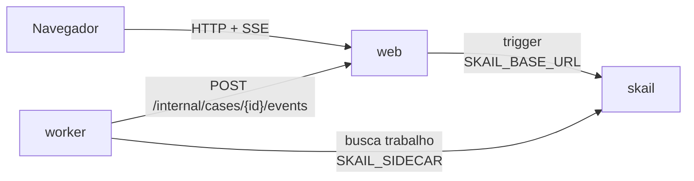

# skail agent with tools (Node / TypeScript + React)

[English](README.md)

Um agente de atendimento construído sobre o skail. Uma function do skail roda o agente num loop: a cada passo, um modelo decide usar uma ferramenta (consultar um pedido, rastrear uma entrega) ou responder ao cliente. Cada decisão e cada uso de ferramenta é um passo gravado, então se o worker parar no meio de um caso, o caso retoma depois do último passo gravado sem perguntar de novo ao modelo. Sem resposta em 6 passos, o caso vai para uma pessoa com a conversa inteira. Com uma chave da OpenAI o modelo é o da OpenAI; sem chave, um planner de exemplo offline decide, então a demo roda sem nenhuma outra conta. Uma página React manda a mensagem do cliente e mostra cada passo do agente ao vivo.

A demo mostra três tópicos da [documentação do skail](https://docs.skail.dev):

- [agente de IA com ferramentas](https://docs.skail.dev/construa/casos-de-uso/agente-de-ia-com-ferramentas): a chamada ao modelo e cada uso de ferramenta são commands, e o loop é código comum na function;
- [replay e determinismo](https://docs.skail.dev/construa/conceitos/replay-e-determinismo): a function só lê resultados gravados, então um caso retomado reconstrói a conversa sem chamar o modelo de novo;
- [retries e idempotência](https://docs.skail.dev/construa/conceitos/retries-e-idempotencia): uma chamada ao modelo que falha é repetida, e as ferramentas só leem dados, então repetir não tem efeito colateral.

## Como funciona



- **worker** (`apps/worker`): a function `AssistCustomer(caseId, question)` e os commands dela, no [`support-agent.ts`](apps/worker/src/support-agent.ts). O `DecideNextStep` pergunta ao modelo qual é o próximo passo, o `UseTool` roda a ferramenta que o modelo escolheu, o `Answer` entrega a resposta ao cliente, o `EscalateToHuman` passa o caso para uma pessoa com a conversa, e o `ReportStatus` avisa a página web do andamento do caso. Os commands delegam para o `AgentOperations`, então a lógica deles é testada sem o skail. O modelo fica em [`planners/`](apps/worker/src/planners), e os dados que as ferramentas leem são simulados no [`order-system.ts`](apps/worker/src/order-system.ts).
- **web** (`apps/web`): API e arquivos estáticos. Inicia o caso (trigger), guarda o estado em memória e transmite para a página (SSE).
- **frontend** (`apps/frontend`): a página, em React 18, Vite e TypeScript.
- **contracts** (`apps/contracts`): tipos, constantes e regras puras usados pelos outros três. Ele também entra no bundle do skail, por isso não importa módulos de I/O do Node.

A function só orquestra e deixa o I/O para os commands. O trecho abaixo é uma versão simplificada do [`support-agent.ts`](apps/worker/src/support-agent.ts), que também avisa a página do início e de uma falha:

```ts
async AssistCustomer(caseId: string, question: string): Promise<CaseResult> {
  const conversation = [Conversation.customer(question)];
  for (let step = 1; step <= AgentLimits.MaxSteps; step++) {
    const decision = await this.DecideNextStep(caseId, step, [...conversation]);
    if (decision.answer != null) return await this.Answer(caseId, step, decision.answer);

    if (decision.tool == null) {
      conversation.push(Conversation.invalidDecision);
      continue;
    }

    const result = await this.UseTool(caseId, step, decision.tool, decision.argument ?? "");
    conversation.push(Conversation.tool(decision.tool, decision.argument, result));
  }
  return await this.EscalateToHuman(caseId, [...conversation]);
}
```

O loop, o `if` e o `continue` são código comum. O modelo e as ferramentas rodam só em commands, e a function lê os resultados gravados deles. Quando um caso retoma, a function roda de novo desde o começo: cada command já concluído devolve o resultado gravado, a conversa é reconstruída do mesmo jeito, e só o passo que não tinha terminado roda. Por isso o modelo é chamado uma vez por passo, mesmo depois de uma queda. Cada `DecideNextStep` recebe a própria cópia da conversa, porque os argumentos de um command são gravados e não podem mudar depois.

Uma decisão sem ferramenta e sem resposta não é um erro: a function acrescenta um aviso na conversa e pergunta de novo, o que gasta um passo. Uma ferramenta desconhecida também vira texto para o modelo (`unknown tool: ...`). Uma chamada ao modelo que falha lança exceção, e o skail repete o `DecideNextStep` até 3 vezes. As ferramentas só leem dados, então repetir o `UseTool` não tem efeito colateral.

## Os caminhos

A página web tem o campo **Customer message** e o botão **Ask**. O planner de exemplo lê a mensagem: com um número de pedido, consulta o pedido, segue o código de rastreio quando existe e responde; sem número, pede o número; e uma mensagem com a palavra "complaint" nunca recebe resposta, para mostrar o encaminhamento.

| O que você pergunta | O que acontece | Resultado |
|---|---|---|
| "Where is my order 1234?" | `LookUpOrder("1234")`, depois `TrackDelivery("BR123456789")`, depois a resposta | **Answered** em 3 passos: "Your delivery is in transit in São Paulo, arriving tomorrow." |
| "Where is my order 5678?" | `LookUpOrder("5678")`; o pedido ainda não tem código de rastreio | **Answered** em 2 passos |
| "Where is my order 9999?" | `LookUpOrder("9999")` não encontra o pedido | **Answered** em 2 passos: pede ao cliente para conferir o número |
| "Hi, I need help" | não há número de pedido | **Answered** em 1 passo: pede o número |
| "I want to file a complaint about order 1234" | 6 decisões sem ferramenta e sem resposta | **Escalated to a human**, com a conversa |
| `scripts/run.sh kill-worker` no meio de um caso, depois `scripts/run.sh start-worker` | o caso retoma depois do último passo gravado | **Answered**, com **Model calls** em 3 |

Com `OPENAI_API_KEY` preenchida, um modelo da OpenAI (`gpt-4o-mini` por padrão) decide com as mesmas ferramentas, e o texto das respostas varia. A página mostra qual planner está em uso.

## Como conecta ao skail

| Serviço | Variável | Para quê |
|---|---|---|
| worker | `SKAIL_SIDECAR` | Conecta a function ao seu environment e recebe o trabalho dela. |
| web | `SKAIL_BASE_URL` | Inicia casos pela API HTTP do skail. |

Os dois usam os mesmos `SKAIL_WORKLOAD`, `SKAIL_NAMESPACE` e `SKAIL_KEY`. O web faz uma chamada por caso:

```http
POST {SKAIL_BASE_URL}/api/v1/trigger/{nome}/{versao}/AssistCustomer/{caseId}
["{caseId}", "Where is my order 1234?"]
```

`{nome}` e `{versao}` vêm de `SKAIL_WORKLOAD` (`nome:versao`). A chamada manda a chave em `skail-key` e em `Authorization: Bearer`, mais o header `Skail-namespace`, como descrito em [autenticação](https://docs.skail.dev/referencia/api-http/autenticacao). `429`, `5xx` e erros de rede são repetidos com o mesmo id do caso. `401` e `403` não são repetidos: confira `SKAIL_KEY` e `SKAIL_NAMESPACE`.

O navegador nunca chama o skail. Ele só fala com o web, então a chave fica no servidor.

## Requisitos

- Node 20, 22 ou 24 e pnpm 10 (`npm i -g pnpm@10.34.7`)
- podman ou docker
- PowerShell 7+ (`pwsh`), só se você usar o `scripts/run.ps1` em vez do `scripts/run.sh`
- Um environment do skail com o workload de `SKAIL_WORKLOAD` cadastrado (`agentwithtools:v1.0.0` por padrão). O [Quickstart](https://docs.skail.dev/comece-aqui/quickstart) mostra como pedir a conta, criar o environment e cadastrar o workload.
- Acesso ao registro público do npm, de onde vêm `@skail/runtime`, `@skail/testing` (2.0.1-rc1) e `@skail/build` (2.0.0).
- Opcional: uma chave de API da OpenAI.
- Um navegador atual (Chrome/Edge 111+, Firefox 113+, Safari 16.2+). A página usa Server-Sent Events.

## Configurar

```bash
cp .env.example .env     # o .env guarda as chaves e é ignorado pelo git
```

Preencha `SKAIL_WORKLOAD` (exatamente como está cadastrado no portal), `SKAIL_NAMESPACE`, `SKAIL_KEY`, `SKAIL_SIDECAR` e `SKAIL_BASE_URL` com os valores do seu environment. Deixe `OPENAI_API_KEY` vazia para usar o planner de exemplo.

O worker recebe `SKAIL_WORKLOAD` e `WEB_BASE_URL` no build ([`gen-config.mjs`](apps/worker/scripts/gen-config.mjs)). Depois de mudar esses valores no `.env`, faça o build de novo; o `scripts/run.sh up` já faz isso. `OPENAI_API_KEY`, `OPENAI_MODEL` e `SAMPLE_PLANNER_DELAY_MS` são lidos pelos commands quando rodam, então a chave nunca entra na imagem; depois de mudar esses valores, rode `scripts/run.sh start-worker`. O `MONITOR_URL`, opcional, é do web e coloca na página um link para o Monitor do skail.

## Rodar com podman ou docker

```bash
scripts/run.sh up        # builda as duas imagens e sobe web + worker
scripts/run.sh logs
scripts/run.sh down
```

`CONTAINER_ENGINE=docker` força o docker. No Windows, ou em qualquer sistema com PowerShell 7+, rode `pwsh scripts/run.ps1 <comando>` com os mesmos comandos; `$env:CONTAINER_ENGINE = "docker"` força o docker.

Abra <http://localhost:8080>, escreva a mensagem do cliente e clique em **Ask**.

### Ver a durabilidade

1. No `.env`, defina `SAMPLE_PLANNER_DELAY_MS=3000` e rode `scripts/run.sh start-worker`. Cada decisão do planner de exemplo passa a levar 3 segundos.
2. Pergunte "Where is my order 1234?".
3. Quando o primeiro resultado de ferramenta aparecer na página, rode `scripts/run.sh kill-worker`. Ele mata o worker com SIGKILL, como numa queda; o caso para, e o web mantém o estado da página.
4. Rode `scripts/run.sh start-worker`.
5. O caso retoma depois do último passo gravado e é respondido. O **Model calls** termina em 3: as decisões gravadas antes da queda não são pedidas de novo.

No portal, abra o [Monitor](https://docs.skail.dev/referencia/portal/monitor) do seu environment e procure pelo id do caso, que a página web mostra no rodapé. A execução lista o `ReportStatus`, depois um `DecideNextStep` por passo, com um `UseTool` depois de cada decisão que escolheu uma ferramenta, e termina com o `Answer` ou o `EscalateToHuman`. As linhas de log dos commands também aparecem na execução, como `Case ... step 1: LookUpOrder(1234) => shipped, tracking code BR123456789`. Para "Where is my order 1234?", o **E2E Duration** foi de 413 ms e o **Duration** de 340 ms.

## VS Code

Abra a pasta e aceite as extensões recomendadas.

- `Ctrl+Shift+B` compila, a task *test* roda os testes e as tasks `containers: up/down/logs/kill-worker/start-worker` chamam o `scripts/run.sh`.
- A configuração de debug **Worker + Web** sobe os dois apps lendo o `.env`, e um breakpoint dentro de um command funciona. A task de build dela grava `WEB_BASE_URL=http://localhost:8080` no bundle, porque fora de container o web fica em `localhost`.
- Para a página com hot reload, rode a task `dev: front end (vite)`. Ela repassa `/api` para o web na porta 8080.

## Testes

```bash
pnpm install
pnpm test
```

Os testes unitários cobrem os contratos, o sistema de pedidos, o planner de exemplo, o planner da OpenAI (com um `fetch` falso) e a escolha do planner pelo ambiente, as operações por trás dos commands, a function em memória com `@skail/testing` (resposta no passo 1, ferramenta e depois resposta, o roteiro inteiro, uma decisão inválida, uma ferramenta desconhecida, o limite de passos e o encaminhamento, uma chamada ao modelo por passo mesmo depois de uma retomada, uma chamada ao modelo repetida), o `skail build` do worker, o estado dos casos, as chamadas ao skail (trigger), a API web com SSE e a página React. Eles não precisam de rede, do skail nem da OpenAI.

## Observações

- O estado dos casos fica na memória do web. Reiniciar o web perde o histórico da página; o caso continua rodando no skail, mas o web ignora os eventos de casos que ele não conhece.
- O sistema de pedidos é simulado no worker. Ele conhece os pedidos 1234 e 5678 e o código de rastreio BR123456789.
- A conversa vai em cada chamada ao modelo, e no histórico de cada uma, por isso os resultados das ferramentas são cortados em 200 caracteres.
- Quando o skail repete uma chamada ao modelo que falhou, o modelo é chamado de novo; só a decisão da tentativa que terminou fica gravada.
- Os avisos de andamento de uma decisão ou de uma ferramenta são de melhor esforço: se o web estiver fora, eles são descartados, para o skail não repetir o command e chamar o modelo de novo.
- A chave da OpenAI fica no ambiente do worker e só vai no header da requisição para a OpenAI. Ela nunca vai para o log nem para a página.
- A rota `POST /internal/cases/{id}/events`, que o worker chama, não tem autenticação. Para uma demo local isso basta; proteja a rota antes de usar o padrão em produção.
- Workers com o mesmo `SKAIL_WORKLOAD` no mesmo environment dividem as mesmas execuções: use um workload (ou environment) por pessoa.

## Licença

[Apache-2.0](LICENSE)
